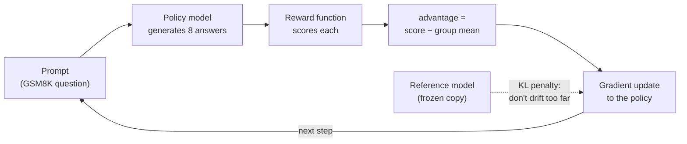
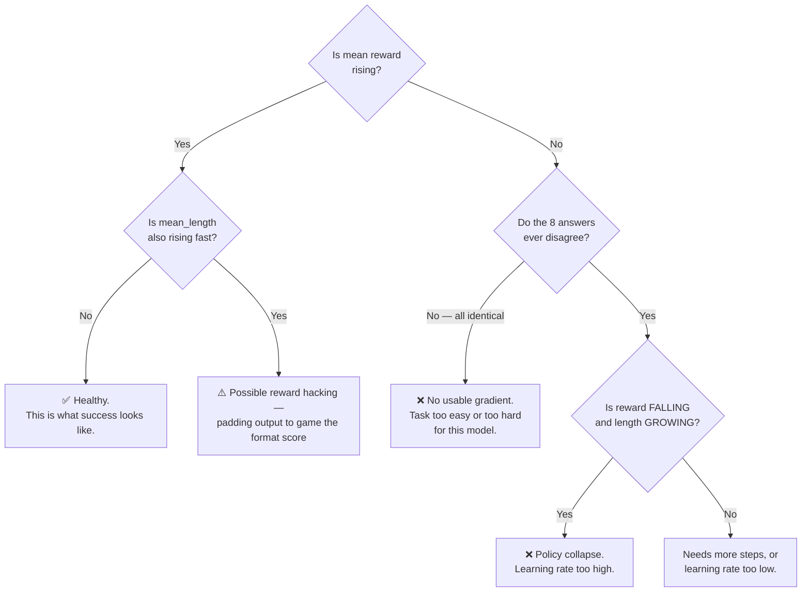

# GRPO on TPU v6e-8 — Workshop Guide (qwen3-0.6b)

**Fine-tune a language model with reinforcement learning on a single TPU v6e-8,
and watch it measurably get better at grade-school math.**

No prior RL experience needed. This guide explains the concepts, then walks you
through the run end to end.

- **Model:** Qwen3-0.6B (600M parameters)
- **Task:** GSM8K grade-school math word problems
- **Algorithm:** GRPO (Group Relative Policy Optimization)
- **Hardware:** one TPU v6e-8 node (8 chips, single host)
- **Time:** ~1 hour (short version) or ~3.5 hours (full version)

---

## Part 1 — The concepts

### 1.1 The three ways to improve a model

Newcomers often hear "SFT", "PEFT/LoRA" and "RL" listed as three alternatives.
They are not. There are **two independent questions**:

| Question | Options |
|---|---|
| **What signal do I learn from?** | SFT (imitate reference answers) vs **RL** (maximize a score) |
| **Which weights do I update?** | Full fine-tuning vs **PEFT/LoRA** (small adapter) |

> [!IMPORTANT]
> **PEFT/LoRA is not an alternative to RL.** It is a memory-saving trick about
> *which* parameters you touch. You can combine any option from row 1 with any
> option from row 2 — "LoRA + GRPO" is a perfectly normal setup.
>
> The real choice this workshop is about is **row 1: SFT vs RL.**

### 1.2 SFT vs RL, concretely

**Supervised Fine-Tuning (SFT)** — *"Here is the correct answer. Copy it."*

```
Prompt: "Natalia sold 48 clips in April and half as many in May..."
Target: "In April she sold 48. In May, 48/2 = 24. Total 48+24 = 72."
Loss:   make the model's tokens match the target tokens.
```

You need a dataset of **written-out correct answers**. The model learns to
imitate their style and content. It never finds out whether *its own* attempts
would have been right.

**Reinforcement Learning (RL)** — *"Try it. I'll score you. Do more of what scored well."*

```
Prompt: "Natalia sold 48 clips in April and half as many in May..."
Model generates 8 different attempts on its own.
A reward function scores each one: 0.37, 0.03, 0.37, 0.03, 0.03, 0.37, 0.03, 0.03
Update: make the high-scoring attempts more likely, the low ones less likely.
```

You need **no reference answers** — only a way to *score* an attempt. Here that's
just "is the final number correct?", which you can check with string comparison.

**Why this matters:** writing reference answers is expensive and requires humans.
Writing a scorer is often trivial. Any time you can *check* a good answer more
easily than you can *write* one — math, code that must compile, JSON that must
parse, tool calls that must succeed — RL is the natural fit.

| | SFT | RL (GRPO) |
|---|---|---|
| Needs | Reference answers | A scoring function |
| Model learns from | Someone else's outputs | **Its own** outputs |
| Optimizes | Token similarity | **The thing you actually care about** |
| Cost per example | Expensive (human-written) | Cheap (automatic) |
| Risk | Copies style without capability | Reward hacking, instability |

### 1.3 What GRPO is

GRPO = **G**roup **R**elative **P**olicy **O**ptimization.

The hard part of RL is the **baseline**: to know whether a score of 0.37 is good,
you need something to compare it against. Classic PPO trains a *second* neural
network (a "critic") to predict expected score. That doubles your memory.

**GRPO's trick: use the group itself as the baseline.**

```
For one prompt, sample G = 8 answers:

  answer 1  score 0.37   ┐
  answer 2  score 0.03   │
  answer 3  score 0.37   │  group mean = 0.15
  answer 4  score 0.03   │
  ...                    ┘

  advantage = score - group mean
    answer 1: +0.22  -> make this more likely
    answer 2: -0.12  -> make this less likely
```

No critic network. That is precisely why this fits on a single v6e-8.



The **frozen reference model** is a copy of the original weights. A KL penalty
keeps the trained model from wandering too far from it — this is the guardrail
against the model destroying its general language ability while chasing reward.

> [!IMPORTANT]
> **The single most important idea in this workshop:**
> if all 8 answers get the *same* score, every advantage is **zero**, and the
> model learns **nothing** from that prompt — no matter how high the score was.
>
> **Learning requires disagreement.** We call the fraction of steps where the 8
> answers disagreed the **usable gradient**. It is the number to watch.

### 1.4 Why a 0.6B model (this surprises people)

We tested Qwen3-**4B** first. It was *worse for learning* — not better.

| | qwen3-0.6b | qwen3-4b |
|---|---|---|
| Usable gradient | **100%** of steps | 16% of steps |
| Why | Often wrong -> the 8 answers disagree | Already good -> all 8 agree, advantage = 0 |

On ~50% of steps, all eight of the 4B model's answers scored a **perfect** 0.3667.
Perfect score, zero learning signal. The model had nothing left to learn from
GSM8K, so the reward curve was flat.

> [!TIP]
> **The lesson generalizes:** RL needs a task that sits at the edge of the
> model's ability. Too easy = no gradient. Too hard = no gradient (everything
> fails equally). A smaller model on a fixed task is often the *better* teaching
> demo, and cheaper too.

---

## Part 2 — What we are actually optimizing

### 2.1 The reward function

Every generated answer is scored by three functions, and the reward is their
**average**:

| # | Function | What it checks | Max points |
|---|---|---|---|
| 1 | `check_numbers` | Is the final number correct? | **1.0** |
| 2 | `match_format_exactly` | Is the output `<reasoning>…</reasoning><answer>…</answer>`? | **0.1** |
| 3 | `match_format_approximately` | Partial credit per tag | **0.0** (disabled) |

```
reward = (1.0 + 0.1 + 0.0) / 3 = 0.3667   <- a PERFECT score
```

> [!WARNING]
> **0.3667 is 100%, not 37%.** This trips up everyone on first read. Rewards in
> this run range roughly **0.0 → 0.3667**. A reward of 0.29 is *good*.
>
> Function 3 is configured to award 0 points (`reward_partial_format_match: 0.0`),
> so it contributes nothing — it is still computed and logged, which is why the
> denominator is 3.

Note the 10:1 weighting. Correctness dominates; formatting is a small nudge.
The model is being taught **"be right, and also be parseable."**

### 2.2 What the model is asked to produce

```
<reasoning>
Natalia sold 48 clips in April. In May she sold 48 / 2 = 24 clips.
Altogether 48 + 24 = 72 clips.
</reasoning>
<answer>72</answer>
```

Nobody ever shows the model an example of this. It discovers that this shape
earns points.

### 2.3 The objective, from two perspectives

**From the user's perspective** — what visibly changes about the model:

| Behaviour | Before training | After ~120 steps |
|---|---|---|
| Output format | Inconsistent; final answer buried in prose | Reliably tagged, trivially parseable |
| Arithmetic accuracy | Baseline | Measurably higher |
| Verbosity | Rambling, restates the question, second-guesses | **~25% shorter** (1037 → 776 chars) |
| Reliability | Sometimes no clear final answer | Almost always emits one |

> [!TIP]
> **The shortening result is the most interesting one.** We never wrote a
> "be concise" rule. The model learned that rambling *costs* it — long meandering
> chains drift into arithmetic errors, which lose the 1.0 correctness point.
> Brevity emerged from optimizing correctness. This is RL discovering a strategy
> that nobody specified.

**From the trainer's perspective** — the four numbers that say it worked:

| Metric | Target | What we measured (run "b8", 119 steps) |
|---|---|---|
| **Mean reward** | rising | 0.2569 → 0.2894 (**+20%**), up in every segment |
| **Usable gradient** | as high as possible | **100%** of steps |
| **Truncation rate** | near 0% | **0%** |
| **KL divergence** | plateau, not climb | plateaued ~0.208 |

```
reward
0.29 ┤                                          ╭───
0.28 ┤                            ╭──────╮╭─────╯
0.27 ┤              ╭─────────────╯      ╰╯
0.26 ┤   ╭──────────╯
0.25 ┤───╯
     └────┬─────┬─────┬─────┬─────┬─────┬─────
          0    20    40    60    80   100   120  steps
```

**KL is the safety metric.** If it climbs without bound, the model is abandoning
its original behaviour to game the reward. Plateauing means it improved *within*
the guardrail. Ours plateaued.

### 2.4 The real goal of this workshop

Not to build a state-of-the-art math model — 0.6B will never be that. The goal is
that you can:

1. Turn "I want the model to do X" into a **reward function**.
2. Run GRPO on real TPU hardware and get a **rising reward curve**.
3. Read the diagnostics well enough to tell **"it is learning"** from
   **"it looks fine but is learning nothing"** (the flat-curve trap).
4. Recognize the failure modes: no usable gradient, truncation, reward collapse.

Point 3 is the one that transfers to every RL project you will ever run.

---

## Part 3 — Running it

### 3.1 Prerequisites

| Requirement | Check |
|---|---|
| GKE cluster with a **v6e-8** node pool (topology `2x4`) | `kubectl get nodes -L cloud.google.com/gke-tpu-topology` |
| `kubectl` pointed at that cluster | `kubectl config current-context` |
| A Hugging Face token | [huggingface.co/settings/tokens](https://huggingface.co/settings/tokens) |
| Pull access to the training image | see step 2 |

> [!CAUTION]
> **It must be v6e-8 specifically** (8 chips, topology `2x4`). The chip count is
> hardcoded in three places that must agree: the `gke-tpu-topology` selector,
> `google.com/tpu: "8"`, and `chips_per_vm=8`. A v6e-4 (`2x2`) or v6e-16 (`4x4`)
> pool will not work without changing all three.

### 3.2 Step 1 — Find your node pool labels

```bash
kubectl get nodes \
  -L cloud.google.com/gke-nodepool \
  -L cloud.google.com/gke-tpu-accelerator \
  -L cloud.google.com/gke-tpu-topology \
  -L cloud.google.com/gke-spot
```

Note the pool name. You will paste it into the manifest in step 4.

If no v6e node is listed, your pool has scaled to zero — that is fine, the
autoscaler will create one when you apply the Job.

### 3.3 Step 2 — Grant image pull access

The container lives in a private Artifact Registry. Your cluster's node service
account needs read access:

```bash
gcloud artifacts repositories add-iam-policy-binding pmotgi-vlm-poc-repo \
  --location=us-east5 \
  --project=northam-ce-mlai-tpu \
  --member="serviceAccount:<YOUR_NODE_SERVICE_ACCOUNT>" \
  --role="roles/artifactregistry.reader"
```

Skip this if you are running on a cluster in the same project that already has
access. If you get `ImagePullBackOff` later, this is why.

### 3.4 Step 3 — Create the Hugging Face secret

The model weights are downloaded from Hugging Face at startup.

```bash
kubectl create secret generic hf-secret \
  --from-literal=hf_api_token=hf_xxxxxxxxxxxxxxxxxxxx
```

The key name **must** be `hf_api_token`.

### 3.5 Step 4 — Edit the manifest

Pick a manifest from this folder — see [Part 6](#part-6--the-manifests-in-this-folder)
for what each one contains. The walkthrough below uses
[`on-demand/qwen3-0.6b-grpo-workshop-portable.yaml`](on-demand/qwen3-0.6b-grpo-workshop-portable.yaml)
as its example; the same three edits apply to any of them.

**Edit 1 — your node pool name** (~line 85):

```yaml
nodeSelector:
  cloud.google.com/gke-nodepool: v6e-8-pool     # <-- YOUR pool name
  cloud.google.com/gke-tpu-accelerator: tpu-v6e-slice
  cloud.google.com/gke-tpu-topology: 2x4
```

**Edit 2 — bump the run name** (~line 124):

```yaml
- run_name=workshop-qwen06-gsm8k-lr2e5-001      # <-- change every run
```

> [!WARNING]
> Checkpoints and metrics both live under `base_output_directory/run_name/`.
> Reusing a name that already has a checkpoint makes the trainer silently
> **resume** instead of starting fresh — you will wonder why your curve starts
> mid-air.

**Edit 3 (optional) — shorten the run.** The default is ~3.5 hours. For a
time-boxed session:

| Setting | Wall clock | Expected reward gain |
|---|---|---|
| `num_batches=120`, `tmicro=1` *(default, fully validated)* | ~3h 30m | **+20%** |
| `num_batches=120`, `tmicro=2` | ~2h 15m | +18% |
| **`num_batches=40`, `tmicro=2`** ← recommended for a workshop | **~55 min** | ~+5% |

"tmicro" means setting **both** `train_micro_batch_size` and
`rollout_micro_batch_size` to the same value.

### 3.6 Step 5 — Run it

```bash
kubectl apply -f on-demand/qwen3-0.6b-grpo-workshop-portable.yaml
kubectl get pods -w
```

Once the pod is `Running`:

```bash
kubectl logs -f job/qwen3-06b-grpo-workshop
```

> [!NOTE]
> **The first ~10 minutes look like nothing is happening.** The container is
> downloading weights from Hugging Face, converting them to Orbax format, and
> pre-compiling the vLLM inference graph. It is not hung.

You will know training has started when you see:

```
Starting RL training...
Training with full_batch_size=8, mini_batch_size=8, train_micro_batch_size=1, ... grad_acc_steps=8
Rendering prompts: 100%|██████████| 8/8
```

> [!TIP]
> `Rendering prompts: 8` confirms micro-batching is working. If you ever see
> `64`, the batch is not being split and the job will run out of memory.

### 3.7 Step 6 — Save your metrics *before* the pod finishes

> [!CAUTION]
> `/checkpoint` is an **emptyDir** — everything is deleted when the pod goes
> away. Worse, `kubectl cp` stops working the moment the pod reaches
> `Succeeded`, **not** when it is deleted. If you wait for the run to finish,
> you have already lost the metrics.

Copy them out **while the run is still going**:

```bash
POD=$(kubectl get pods -l app=qwen3-06b-grpo-workshop -o name | head -1)
kubectl cp ${POD#pod/}:/checkpoint/maxtext-qwen3-0p6b/<run_name>/tensorboard ./tb
```

The `kubectl logs` output is safe — it survives until the Job is deleted.

### 3.8 Step 7 — Clean up

```bash
kubectl delete job qwen3-06b-grpo-workshop
```

The node pool scales back to zero on its own a few minutes later.

---

## Part 4 — Reading your results

### 4.1 Metrics to plot

| Tag | Meaning | Healthy |
|---|---|---|
| `rewards/train/mean` | average score | **rising** |
| `rewards/train/check_numbers` | correctness component | rising |
| `completions/train/mean_length` | answer length | flat or **falling** |
| `actor/train/kl` | drift from the original model | rises then **plateaus** |

### 4.2 Diagnosing what you see



> [!TIP]
> **Check length before you blame the task.** A falling reward with *growing*
> answers is almost always an unstable learning rate, not a hard dataset. We hit
> this at `lr=5e-5`: reward **−79%**, answers doubled from 922 to 1780 chars, 49%
> hit the token limit, KL ran away to 1.17. At `2e-5` everything is stable.

### 4.3 Things in the logs that are normal

These appear in every healthy run. **Do not chase them:**

```
ERROR ... tpu_info.py:40   (followed by a block of Google 404 HTML)
AOT lower skipped ... ShardingTypeError
cuInit: UNKNOWN ERROR (303)
Increase the page size from 16 to 32 to avoid SMEM OOM
```

And at the very end, **after** training and checkpointing have finished:

```
AttributeError: 'Qwen3ForCausalLM' object has no attribute 'modules'
```

This fires during interpreter shutdown. The pod still **exits 0** and the Job is
still marked **Complete**. Check `kubectl get job` rather than trusting the last
line of the log.

---

## Part 5 — Troubleshooting

| Symptom | Cause | Fix |
|---|---|---|
| Pod `Pending`, `FailedScheduling` | No v6e node yet | Normal — autoscaler is provisioning. Wait ~5–15 min. |
| Pod `Pending` for >20 min | **Capacity stockout** | `kubectl describe pod` → look for `ZONE_RESOURCE_POOL_EXHAUSTED`. Try another zone/region. |
| `ImagePullBackOff` | No registry access | Step 2 above |
| `CreateContainerConfigError` | `hf-secret` missing or wrong key | Step 3 — key must be `hf_api_token` |
| Dies ~2 min after "Starting RL training" with `RESOURCE_EXHAUSTED` | Micro-batching off | Ensure `train_micro_batch_size=1` **and** `rollout_micro_batch_size=1` |
| Reward flat at exactly 0.3667 | Task too easy | Expected with larger models — that is a perfect score |
| Curve starts mid-air | Resumed an old checkpoint | Bump `run_name` |

> [!WARNING]
> **The out-of-memory error does not appear at startup.** The job logs
> "Starting RL training...", renders prompts, and looks completely healthy for
> about two minutes — then dies on the first real training step. Never conclude
> a config is safe just because training started.

---

## Part 6 — The manifests in this folder

All three run the same GRPO recipe. They differ only in how the Kubernetes Job is
packaged and where checkpoints are written.

| File | Packaging | Storage | Steps |
|---|---|---|---|
| [`on-demand/qwen3-0.6b-grpo-workshop-portable.yaml`](on-demand/qwen3-0.6b-grpo-workshop-portable.yaml) | Plain `batch/v1` Job | `emptyDir` (ephemeral) | 120 |
| [`spot/qwen3-0.6b-grpo-workshop-portable-spot.yaml`](spot/qwen3-0.6b-grpo-workshop-portable-spot.yaml) | Plain `batch/v1` Job + preemption tolerations, `backoffLimit`, `podFailurePolicy` | `emptyDir` (ephemeral) | 40 |
| [`spot/qwen3-0.6b-grpo-workshop-v6e-8.yaml`](spot/qwen3-0.6b-grpo-workshop-v6e-8.yaml) | JobSet CRD | gcsfuse PVC (durable) | 120 |

**Choosing between them:**

- The two **portable** files need nothing beyond a TPU node pool and a secret —
  no JobSet controller, no PVC, no workload identity. They are the easiest to
  drop onto an unfamiliar cluster.
- The **JobSet** file writes checkpoints and metrics to a GCS bucket, so results
  survive the pod. It requires the JobSet CRD, the gcsfuse CSI driver, a
  pre-existing PVC and a workload-identity service account, and its values are
  hard-wired to one specific cluster — expect to edit it.
- The **`-spot` file** adds Job-level retry handling for interruptible nodes.
  Use it if your node pool can be reclaimed mid-run.

**What has actually been run end to end:** the on-demand portable file, to
completion — exit 0, 120 steps, 3h24m, zero OOM. The other two use the same
verified training arguments, but their packaging has not been run start to
finish.

> [!NOTE]
> **If your nodes can be interrupted mid-run**, two behaviours are worth knowing
> about, independent of which file you pick:
> - With **durable storage**, a restart resumes from the last *saved* checkpoint
>   rather than the furthest step reached, so the step counter can move
>   **backwards** (we observed 49 → 30 → 2).
> - With **`emptyDir`**, a restart loses everything and begins cleanly from step
>   0, re-paying the ~10 minute startup.
>
> Shorter runs (`num_batches=40`) are correspondingly easier to complete.

---

## Part 7 — Where to go next

- **Change the reward** → [`../../CUSTOM_DATASET_AND_REWARDS_GUIDE.md`](../../CUSTOM_DATASET_AND_REWARDS_GUIDE.md).
  This is the highest-value experiment: reward brevity, a specific output schema,
  or anything you can score programmatically.
- **Track experiments** → [`../../MLFLOW_METRICS_GUIDE.md`](../../MLFLOW_METRICS_GUIDE.md)
- **Coming from HuggingFace TRL?** → [`../../TRL_TO_MAXTEXT_MAPPING.md`](../../TRL_TO_MAXTEXT_MAPPING.md)
- **Other model sizes** → [`../README.md`](../README.md)

### Safe knobs to experiment with

| Knob | Safe range | Effect |
|---|---|---|
| `num_batches` | 20 – 200 | More steps, more improvement |
| `learning_rate` | 3e-6 – **2e-5** | Higher learns faster. **Never exceed 2e-5** — 5e-5 collapses the model. |
| `rl.num_generations` | 4 – 8 | More samples per prompt = less noisy advantage, slower |
| `batch_size` | 4 – 8 | More prompts averaged per step |

> [!IMPORTANT]
> **Memory sizing rule.** `train_micro_batch_size` controls how many sequences
> are in flight on the chips at once. Keep:
>
> ```
> sequences in flight = train_micro_batch_size * rl.num_generations  <=  16
> ```
>
> | Config | Sequences in flight | Fits 0.6B? |
> |---|---|---|
> | `tmicro=1`, `num_generations=8` *(shipped default)* | 8 | ✅ comfortably |
> | `tmicro=2`, `num_generations=8` *(fast variant)* | 16 | ✅ at the limit |
> | `tmicro=-1` *(the stock `rl.yml` value — means "do not split")* | **64** | ❌ out of memory |
>
> `batch_size` itself is safe to raise: with `tmicro=1`, a `batch_size` of 8 is
> processed as 8 sequential gradient-accumulation steps, not all at once. It
> costs time, not memory.

---

## Appendix — Glossary

| Term | Meaning |
|---|---|
| **Policy** | The model being trained. In RL the model *is* the policy: it decides what tokens to emit. |
| **Rollout** | Generating sample answers from the policy so they can be scored. |
| **Reward** | The score given to one answer. Here, 0.0 → 0.3667. |
| **Advantage** | `reward − group mean`. Positive = better than its peers = reinforce it. |
| **Usable gradient** | The fraction of steps where the 8 answers disagreed. Agreement = zero advantage = no learning. |
| **KL divergence** | How far the trained model has drifted from the original. The safety metric. |
| **Reference model** | A frozen copy of the starting weights, used to compute KL. |
| **Truncation** | An answer hitting the token limit before finishing. Its reward is meaningless. |
| **Micro-batch** | A slice of the batch small enough to fit in memory, processed one at a time. |
| **Gradient accumulation** | Summing gradients across micro-batches before one weight update — same math, less memory. |
| **HBM** | High Bandwidth Memory, the TPU's on-chip RAM. 31.25 GB per v6e chip. |
| **Orbax** | JAX's checkpoint format. HF weights are converted to it at startup. |
| **Reward hacking** | Finding a way to score well without doing the intended task. |
